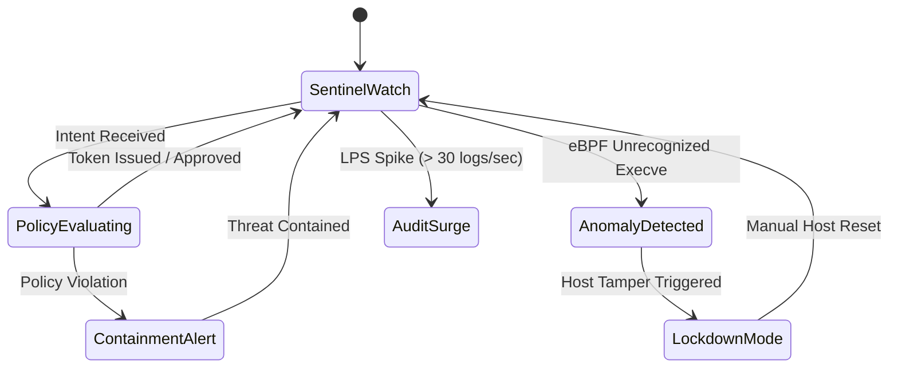
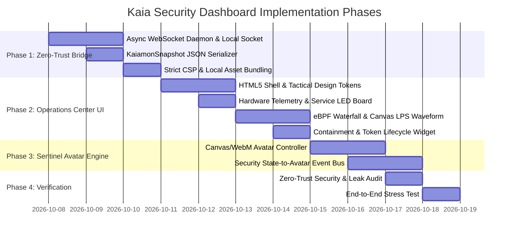

# Kaia Hardened AI Security Agent: Curses TUI to Cyber-Sentinel Operations Center & Animated Kaia Guardian Specification

**Date:** 2026-10-07  
**Analyst:** Antigravity (Security Architecture & UI/UX Systems Engineering)  
**Target Repository:** [`/home/ekco/github/Kaia/`](file:///home/ekco/github/Kaia/)  
**Document Type:** Feasibility Analysis & Architectural Design Specification  
**Destination Path:** [`docs/reports/investigations/2026-10-07-kaia-hardened-security-ui-upgrade-design-spec.md`](file:///home/ekco/github/Kaia/docs/reports/investigations/2026-10-07-kaia-hardened-security-ui-upgrade-design-spec.md)  
**Primary Design References:**
* Kaiacord Cyber-Deck Audio UI: [`assets/dj/index.html`](file:///home/ekco/github/Kaiacord/assets/dj/index.html) (1,863 lines of standalone HTML5/CSS3/Canvas reactive cyber-deck audio dashboard)
* Kaiacord Waterfall/Scanner UI: [`assets/rx/index.html`](file:///home/ekco/github/Kaiacord/assets/rx/index.html) (604 lines of real-time SDR/waterfall telemetry and status HUD)
* Kaia Current Dashboard: [`kaia_dashboard.py`](file:///home/ekco/github/Kaia/kaia_dashboard.py) (2,300+ lines of curses TUI dashboard with thread-safe `KaiamonSnapshot` architecture)
* Kaia Core Security Subsystems:
  - Policy Gate & Tokens: [`security/policy_gate.py`](file:///home/ekco/github/Kaia/security/policy_gate.py)
  - eBPF Telemetry (`execve`, `openat2`): [`security/ebpf_telemetry.py`](file:///home/ekco/github/Kaia/security/ebpf_telemetry.py)
  - Host Executor & Sandboxing: [`security/host_executor.py`](file:///home/ekco/github/Kaia/security/host_executor.py)
  - Raw Packet Discovery: [`security/network_discovery.py`](file:///home/ekco/github/Kaia/security/network_discovery.py)
  - Threat Intelligence & Shodan: [`security/threat_intel.py`](file:///home/ekco/github/Kaia/security/threat_intel.py)
  - File Integrity Monitoring (fanotify): [`security/fim_daemon.py`](file:///home/ekco/github/Kaia/security/fim_daemon.py)
* Kaia Character Reference Assets:
  - Visual Blueprint & Traits: `images/50f2b8cf-20f9-4598-aab4-f225f3f2b873.png` (`kaia_ui_mockup.png`)
  - Expression Matrix & Poses: `images/Untitled.jpg`, `images/Untitled03.jpg`
  - Integrated HUD Mockup: `images/Untitled01.jpg`
  - 3D Animated Sequence: `images/kaia_39.gif`

---

## 1. Executive Summary & Vision

The `Kaia` project is a local-first, zero-trust AI security administration subsystem and host guardian for Linux. It operates under five strict architectural axioms: all LLM outputs are untrusted; all actions are schema-validated; the host makes execution decisions; security policy is decoupled from personality; and every boundary fails closed.

Currently, Kaia’s operator interface is implemented as a 2,300-line Python `curses` terminal dashboard ([`kaia_dashboard.py`](file:///home/ekco/github/Kaia/kaia_dashboard.py)), known as `KaiamonUI`. While architecturally solid with background collector threads and a thread-safe snapshot engine (`KaiamonSnapshot`), its terminal-based presentation restricts situational awareness:
* Syscall events and packet flows are flattened into standard terminal text grids.
* Log velocity (LPS) is constrained to a 10-character Unicode sparkline (` ▂▃▄▅▆▇█`).
* The system guardian persona is completely invisible, presenting no visual representation of Kaia’s affective state, policy evaluation focus, or active defensive stance.

This document specifies the upgrade of `Kaia`'s monitoring layer into a **Cyber-Sentinel Operations Center (SOC)**, porting the high-performance HTML5/CSS/Canvas and WebSocket foundations of `Kaiacord`'s [`assets/dj/index.html`](file:///home/ekco/github/Kaiacord/assets/dj/index.html) and [`assets/rx/index.html`](file:///home/ekco/github/Kaiacord/assets/rx/index.html).

Crucially, this upgrade introduces an **Interactive Kaia Security Sentinel Avatar**: an animated 2D/3D visual operative viewport embedded directly into the security HUD, whose biometric states, fiber-optic data streams, and facial expressions react in real time to host integrity events, policy gate evaluations, eBPF intercepts, and threat intelligence alerts.

---

## 2. Forensic Analysis of Kaia's Telemetry Architecture

A significant advantage of `Kaia`'s current codebase is that [`kaia_dashboard.py`](file:///home/ekco/github/Kaia/kaia_dashboard.py) already enforces strict separation between background data collection and UI rendering:

```
┌────────────────────────────────────────────────────────────────────────┐
│                   KAIA COLLECTOR SUBSYSTEM POOL                        │
├──────────────────────────┬─────────────────────────────────────────────┤
│ Collector Thread         │ Monitored Telemetry & Security Metrics      │
├──────────────────────────┼─────────────────────────────────────────────┤
│ SystemSecurityCollector  │ CPU%, RAM%, NVML GPU (temp/vram), ping      │
│ ContainmentCollector     │ Capability Tokens, eBPF execve/openat2, FIM │
│ ThreatIntelCollector     │ AF_PACKET L2/L3 sniff, Shodan, connections  │
│ ServiceCollector         │ systemd: ollama, postgresql, PolicyGate     │
│ AuditLogCollector        │ SQLite append-only ledger, LPS rate, peaks  │
└──────────────────────────┴─────────────────────────────────────────────┘
                                  │
                                  ▼
           [ CollectorManager.take_snapshot() -> KaiamonSnapshot ]
                                  │
                                  ▼
                 Current: KaiamonUI (curses terminal)
                 Target:  Cyber-Sentinel Web Bridge (WebSocket/Canvas)
```

Because `CollectorManager.take_snapshot()` produces an immutable, fully serializable `KaiamonSnapshot` dataclass every 100ms, transitioning from curses to a web socket stream requires **zero changes to Kaia's core security daemons or collectors**.

---

## 3. Zero-Trust Security Invariants for the Web UI

Because `Kaia` is a hardened security guardian defending against malicious LLM actions, the web interface must never compromise host containment. The UI architecture must adhere to the following invariants:

1. **Loopback & Socket Isolation**: The web server binds exclusively to `127.0.0.1` (or a local Unix Domain Socket at `/run/kaiacord/ui.sock`). It must never bind to `0.0.0.0` or be exposed to external network interfaces.
2. **One-Way Telemetry Push**: The default WebSocket stream is strictly read-only outbound broadcast. No arbitrary shell commands can be pushed through the websocket.
3. **Deterministic Policy Gate Enforcement**: Any interactive operator commands entered via the UI must serialize into strict Pydantic `CommandIntent` payloads and pass through [`security/policy_gate.py`](file:///home/ekco/github/Kaia/security/policy_gate.py) over the Unix Domain Socket, with capability token validation.
4. **Air-Gapped Local Assets**: All CSS, fonts (Orbitron, JetBrains Mono), and JavaScript bundles must be packaged and served locally from disk. No external CDN calls (Google Fonts, unpkg, etc.) are allowed at runtime, preventing tracking or supply-chain injection.
5. **Strict Content Security Policy (CSP)**: `default-src 'self'; script-src 'self'; style-src 'self'; img-src 'self' data:; connect-src 'self' ws://127.0.0.1:*`.

---

## 4. Cyber-Sentinel HUD Design System & Layout

Porting the visual tokens from `Kaiacord`:

```
┌────────────────────────────────────────────────────────────────────────┐
│                     CYBER-SENTINEL DESIGN SYSTEM                       │
├─────────────────────────────────┬──────────────────────────────────────┤
│ Deep Void Background (--bg)     │ #04060c                              │
│ Tactical Panel Slate (--panel)  │ #0a0e19 -> #0d1322 (gradient)        │
│ Tactical Cyan (--cyan)          │ #00f0ff (Policy check / Host normal) │
│ Emerald Laser Green (--green)   │ #3dff8a (Integrity verified / Active)│
│ Warning Amber (--yellow)        │ #ffe45c (Elevated review / Sandboxed)│
│ Critical Crimson Alert (--red)  │ #ff3860 (Policy breach / Containment)│
│ Neural Violet Accent (--purple) │ #a259ff (LLM reasoning / Policy Gate)│
│ CRT Scanline & Grid Effect      │ Repeating 2px lines, 32px cyber grid │
│ Display Typography              │ 'Orbitron', 'JetBrains Mono', sans   │
│ Data Typography                 │ 'JetBrains Mono', monospace          │
└─────────────────────────────────┴──────────────────────────────────────┘
```

### Screen Layout Composition:

```
┌────────────────────────────────────────────────────────────────────────────────────────────────┐
│ [●] KAIA // HARDENED SECURITY SENTINEL   HOST: Arch-Linux  POLICY: ENFORCED  LPS: 12.4  04:40:20│ [Header]
├───────────────────────────────────────┬────────────────────────────────────────────────────────┤
│ ┌─ SYSTEM SECURITY & TELEMETRY ─────┐ │ ┌─ TACTICAL SENTINEL OPERATIVE (KAIA) ───────────────┐ │
│ │ CPU: [||||||||  ] 42%   4.8 GHz   │ │ │                                                    │ │
│ │ RAM: [||||||    ] 18.2 / 32 GB    │ │ │         [ 3D/CANVAS KAIA SENTINEL AVATAR ]         │ │
│ │ GPU: RTX 4090  54°C  VRAM: 8.4GB  │ │ │       (Translucent Crystal Body, Glowing Spine,    │ │
│ │ SERVICES:                         │ │ │        Emerald Fiber Hair, Tactical HUD Eyes)      │ │
│ │  [●] Ollama  [●] Postgres [●] Gate│ │ │                                                    │ │
│ │ PING: 1.1.1.1 (12ms) [ ▂▃▂ ]      │ │ │ STATUS: SENTINEL WATCH        THREAT LEVEL: LOW    │ │
│ └───────────────────────────────────┘ │ └────────────────────────────────────────────────────┘ │
├───────────────────────────────────────┼────────────────────────────────────────────────────────┤
│ ┌─ eBPF SYSCALL WATERFALL ──────────┐ │ ┌─ CONTAINMENT & CAPABILITY LEDGER ──────────────────┐ │
│ │ sys_enter_execve / sys_enter_openat2│ │ ACTIVE TOKENS:                                       │ │
│ │ 04:40:12  /usr/bin/curl -> [BLOCKED]│ │  • [TOK-94A1] READ_LOGS      TTL: 00:04:12 [████░]  │ │
│ │ 04:40:15  /usr/bin/python3 [SANDBOX]│ │  • [TOK-F280] DISK_TELEMETRY TTL: 00:01:45 [██░░░]  │ │
│ │ (Real-time scrolling heatmap lane)  │ │ POLICY GATE: 0 Violations | Sandbox: Enforced       │ │
│ └───────────────────────────────────┘ └────────────────────────────────────────────────────────┘ │
├───────────────────────────────────────────────────────┬────────────────────────────────────────┤
│ ┌─ THREAT INTELLIGENCE & NETWORK RADAR ─────────────┐ │ ┌─ AUDIT LEDGER & LOGS/SEC OSCILLOGRAM─┐
│ │ AF_PACKET Discovery | Shodan InternetDB Sync       │ │ │ LPS: 12.4 (Peak: 48.0)               │
│ │ Local Entities: 14  Suspicious: 0  Rogue APs: 0   │ │ │ [~~\_/\~~~--~--\_/] (Rolling Canvas) │
│ │ Active Sockets: 88  External Shodan Score: 0/10   │ │ │ [04:40:18] POLICY_GATE: Intent Valid │
│ └───────────────────────────────────────────────────┘ │ │ [04:40:19] eBPF: execve logged      │
│                                                       │ └──────────────────────────────────────┘
└───────────────────────────────────────────────────────┴────────────────────────────────────────┘
```

---

## 5. Kaia Character: The Tactical Security Sentinel Avatar

### 5.1 Persona & Visual Design
Kaia’s visual identity matches the high-resolution reference sheet (`kaia_ui_mockup.png` and `Untitled03.jpg`):
* **Synthetic Android Construction**: Transparent crystal-polymer shell exhibiting glass refraction, Fresnel highlights, and internal mechanical ribbing.
* **Neural Conduit Illumination**: Vertical emerald-green fiber-optic conduits running up the spine, neck, and limbs, representing live system data bus activity.
* **Fiber-Optic Bob Hair**: Luminous emerald green fiber-optic strands that flare or pulse based on processor load and threat severity.
* **Tactical Iris HUD**: Concentric targeting and diagnostic rings in her emerald irises that contract, rotate, and expand during threat analysis.

### 5.2 Security Event to Avatar Reaction State Machine

Kaia’s facial expression, conduit glow, and movement dynamically reflect the security posture of the host system:



| Security System Event | Target Avatar Expression | Visual FX, Lighting & Conduits | Behavioral Animation |
| :--- | :--- | :--- | :--- |
| **Normal Host Operation** (No alerts, all services up) | **NEUTRAL / CALM** | Soft emerald-green glow; steady 60 BPM ambient breathing pulse. | Gentle idle sway; steady forward gaze; periodic blink. |
| **Policy Gate Evaluating** (LLM request submitted) | **DETERMINED** | Conduits turn cyan (`#00f0ff`); rapid upward data pulse; iris reticles rotate. | Eyes focus sharply on operator; posture straightens. |
| **eBPF Anomaly / Unknown Process** | **ANNOYED / SKEPTICAL** | Conduits shift to amber (`#ffe45c`); micro-sparks at hair tips. | Head tilts slightly; furrowed brow; scanning ocular saccade. |
| **Policy Violation / Gate Rejection** | **ANGRY** | Conduits flare crimson red (`#ff3860`); chromatic aberration pulse. | Sharp defensive recoil; stern, protective scowl. |
| **Active Containment Breach / Tamper Tripwire** | **FRIGHTENED / COMBAT READY** | Full red emergency strobing; digital glitch artifacts across body. | Hands raise into defensive stance; red digital shield hexagon overlay. |
| **Audit Ledger Surge** (LPS > 35) | **DATA OVERLOAD (DEBUG)** | Vertical binary matrix cascade washes down transparent torso. | Fast eye micro-movements as if reading incoming telemetry stream. |
| **System Idle / Low Resource Mode** | **EXHAUSTED / SLEEPY** | Conduits dim to 15% luminescence; slow 20 BPM pulse; pale teal tone. | Head rests slightly down; eyelids half-closed in standby power-save. |

---

## 6. Real-Time Canvas Security Telemetry Widgets

1. **eBPF Syscall Waterfall**:
   - Inspired directly by Kaiacord’s RF spectrum waterfall ([`assets/rx/index.html`](file:///home/ekco/github/Kaiacord/assets/rx/index.html)).
   - Visualizes live kernel `sys_enter_execve` process launches and `sys_enter_openat2` file touches as a vertical cascading spectrogram. Safe processes render in glowing emerald/cyan; unverified or sandboxed calls render in amber; blocked or hostile executions blaze in crimson red.
2. **Containment Sandbox & Token Ring Visualizer**:
   - Renders active cryptographic capability tokens as glowing hexagonal chips.
   - Each token displays its signed permission scope (e.g., `READ_NETWORK`, `EXEC_PROBE`), cryptographic fingerprint, and a circular SVG countdown ring indicating time-to-live (TTL) expiration.
3. **Threat Intel & Network Topology Radar**:
   - Displays live connections from `AF_PACKET` socket interceptors as nodes radiating from the local host core.
   - Integrates cached Shodan InternetDB threat scoring with color-coded risk gauges (0/10 green, 5/10 amber, 10/10 red).
4. **Logs Per Second (LPS) Oscillogram**:
   - Upgrades the 10-character terminal sparkline to a continuous 60 FPS HTML5 Canvas oscillogram.
   - Renders rolling 60-second event frequency curves with dynamic peak scaling and threshold breach markers.

---

## 7. Implementation Roadmap for Claude Opus 5.5



### Detailed Execution Steps for Opus 5.5:
1. **Develop `core/web_bridge.py`**:
   - Attach a non-blocking WebSocket server to `CollectorManager` in [`kaia_dashboard.py`](file:///home/ekco/github/Kaia/kaia_dashboard.py).
   - Broadcast the existing `KaiamonSnapshot` object as JSON over `127.0.0.1:8765` or `/run/kaiacord/dashboard.sock`.
   - Preserve `--tui` CLI flag to ensure headless terminal operation remains fully intact.
2. **Build the Frontend Architecture (`static/dashboard/`)**:
   - Standalone single-page app adhering strictly to zero-trust invariants (no remote external dependencies).
   - Implement the CSS design system: Orbitron headers, JetBrains Mono data tables, tactical corner brackets, CRT scanline overlay, glowing alert badges.
3. **Build the eBPF Waterfall & Telemetry Widgets**:
   - Implement `SyscallWaterfallCanvas` rendering `execve` and `openat2` activity at 60 FPS.
   - Implement `LpsOscillogramCanvas` with auto-scaling peak history.
4. **Integrate the Kaia Sentinel Avatar Subsystem**:
   - Implement `SentinelAvatarController` handling idle breathing loops and cross-fading into Alert, Evaluating, or Breach animations upon state changes from `KaiamonSnapshot.containment`.

---

## 8. ChatGPT Text-to-Image Generation Prompting Suite

The following prompt instructions are tailored for ChatGPT (DALL-E 3) or Midjourney to produce ultra-realistic UI mockup references. Provide these visual mockups directly to Claude Opus 5.5 during the implementation phase.

### Master Prompt 1: Kaia Cyber-Sentinel Security Operations Center UI Mockup

> **Copy-Paste Instructions for ChatGPT / DALL-E 3:**
> 
> ```text
> Ultra-detailed, photorealistic screenshot of a high-tech Linux cyber-defense tactical operations center user interface named "KAIA // ZERO-TRUST SECURITY SENTINEL". Dark military cyber-deck HUD aesthetic with deep void black background (#04060c), sleek charcoal panels (#0a0e19), and glowing tactical neon cyan (#00f0ff), laser emerald green (#3dff8a), warning amber (#ffe45c), and critical red (#ff3860) indicators. Subtle CRT monitor scanlines, glowing grid backdrop, and cyber corner brackets on all panels.
> 
> Layout & Panels:
> 1. Top Header Bar: Displays "[●] KAIA // HARDENED SECURITY SENTINEL", status indicators "HOST: Arch-Linux | POLICY GATE: ACTIVE | LPS: 12.4 | THREAT LEVEL: LOW", and a glowing digital system clock in neon green Orbitron font.
> 2. Top-Left Panel: "SYSTEM SECURITY & HOST TELEMETRY" displaying real-time gauges for CPU load, RAM usage, NVIDIA RTX 4090 GPU temperature (54°C) with glowing bar graphs, systemd service indicators (Ollama, PostgreSQL, PolicyGate glowing green), and ping latency sparklines.
> 3. Top-Right Panel: "TACTICAL SENTINEL OPERATIVE" showing a high-detail 3D character viewport of KAIA, the female AI security guardian. Kaia is a synthetic android with a completely transparent, crystal-polymer glass body displaying internal glowing emerald-green fiber-optic conduits, glowing optical spine, and flowing code data streams. She has a luminous emerald-green fiber-optic bob haircut, glowing green eyes with concentric holographic HUD reticle rings, and subtle freckles on her face. Her expression is alert, vigilant, and protective. Underneath her viewport is a badge: "STATUS: SENTINEL WATCH | ZERO-TRUST ENFORCED".
> 4. Middle-Left Panel: "eBPF SYSCALL WATERFALL & CONTAINMENT" showing a live cascading spectrogram waterfall of intercepted kernel sys_enter_execve and sys_enter_openat2 syscalls with glowing colored data lines.
> 5. Middle-Right Panel: "CAPABILITY TOKEN LEDGER" displaying active cryptographic tokens with permissions like "READ_LOGS" and circular glowing SVG countdown rings showing token TTL expiration.
> 6. Bottom Panels: "THREAT INTELLIGENCE & NETWORK RADAR" showing local network discovery nodes and Shodan risk gauges on the left; and on the right, an "AUDIT LEDGER & LOGS/SEC OSCILLOGRAM" showing a rolling neon green wave graph of event velocity and a live colorized security audit stream.
> 
> Unreal Engine 5 UI render, 8k resolution, razor-sharp vector typography, futuristic cybersecurity command center, dribbble award-winning design, octane render.
> ```

### Master Prompt 2: Kaia Sentinel Emergency Containment & Breach Mode UI Mockup

> **Copy-Paste Instructions for ChatGPT / DALL-E 3:**
> 
> ```text
> Ultra-detailed screenshot of the futuristic "KAIA // ZERO-TRUST SECURITY SENTINEL" desktop HUD interface during an active security containment event / cyber intrusion lockdown. High-contrast dark cyber-deck aesthetic dominated by urgent emergency crimson red (#ff3860) and glowing warning amber (#ffe45c) alerts.
> 
> Scene Details:
> 1. In the "TACTICAL SENTINEL OPERATIVE" viewport, the female AI character KAIA is in a tense, protective defensive stance. Her transparent crystal-glass body pulses with bright crimson-red optical data streams and flashing warning pulses along her spine. Her luminous fiber-optic bob hair glows bright red-orange, her eyes display flashing warning reticles, and holographic red hexagonal containment shields float around her. Her expression is fierce, determined, and protective. A large red banner beneath reads "CONTAINMENT BREACH CONTAINED // POLICY GATE LOCKDOWN".
> 2. The "eBPF SYSCALL WATERFALL" shows a spike of glowing red blocked execution traces for unauthorized binaries.
> 3. The "AUDIT LEDGER" pane rapidly scrolls bright red and amber alerts: "[VIOLATION] Capability Token Revoked", "[eBPF] sys_enter_execve blocked for /tmp/payload", "[TAMPER] Immutable ledger locked".
> 4. The "LOGS PER SECOND" waveform shows a dramatic red spike peaking off the chart scale.
> 5. Heavy CRT scanlines, chromatic aberration glitch effects, cinematic red volumetric lighting, 8k resolution, tactical cybersecurity UI masterpiece.
> ```

---

## 9. Conclusion & Execution Alignment

Both `Kaiagotchi` and `Kaia` share the same foundational AI persona (Kaia) and can now share a unified, battle-tested cyber-deck visual design system derived from `Kaiacord`.

With this comprehensive specification and the accompanying prompt suites, all requirements are locked:
1. The architectural mechanics and thread-safe snapshot serialization are documented down to exact file and class references.
2. The character animation state-machine bridges Kaia's emotional and security states to real-time visual reactions.
3. The ChatGPT prompting suite provides instant, high-fidelity visual targets to guide Claude Opus 5.5 in delivering flawless UI upgrades across both repositories.
